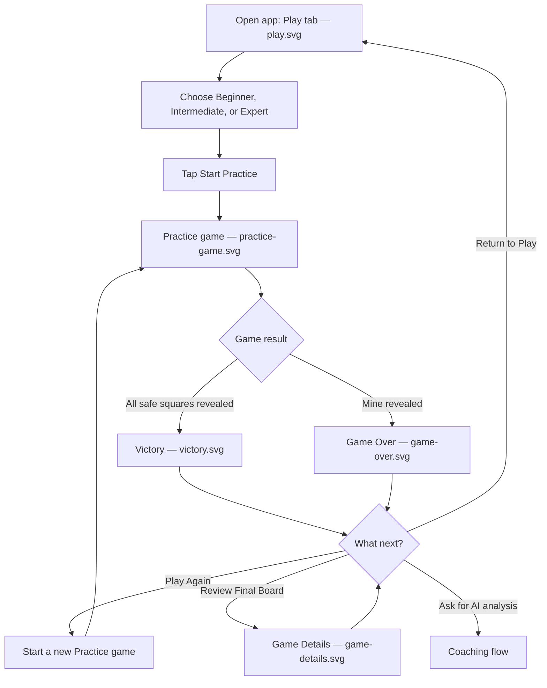
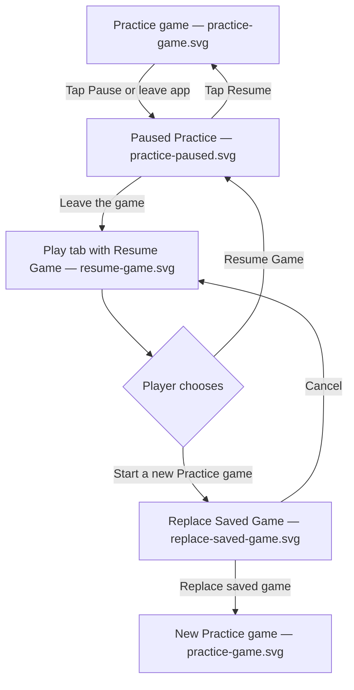
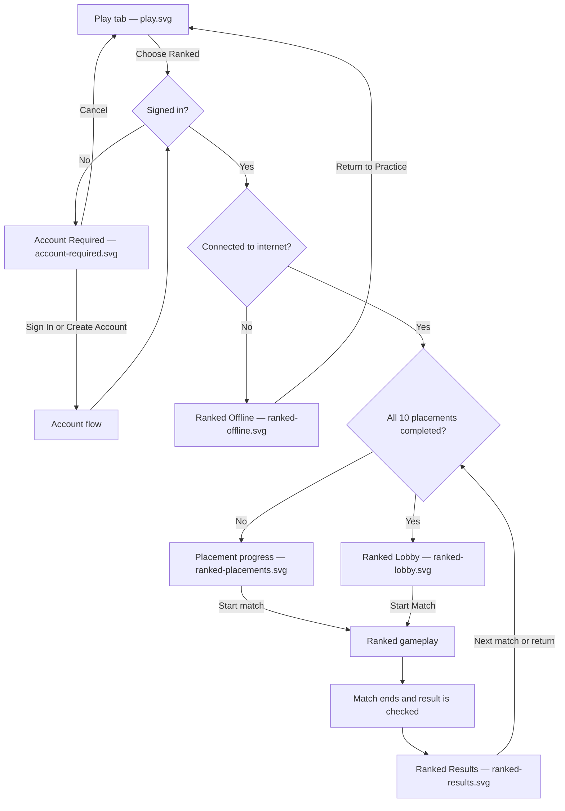
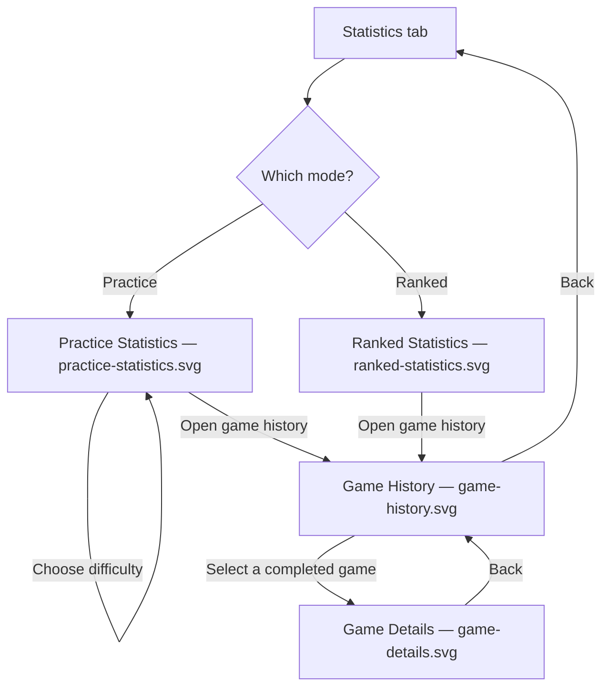
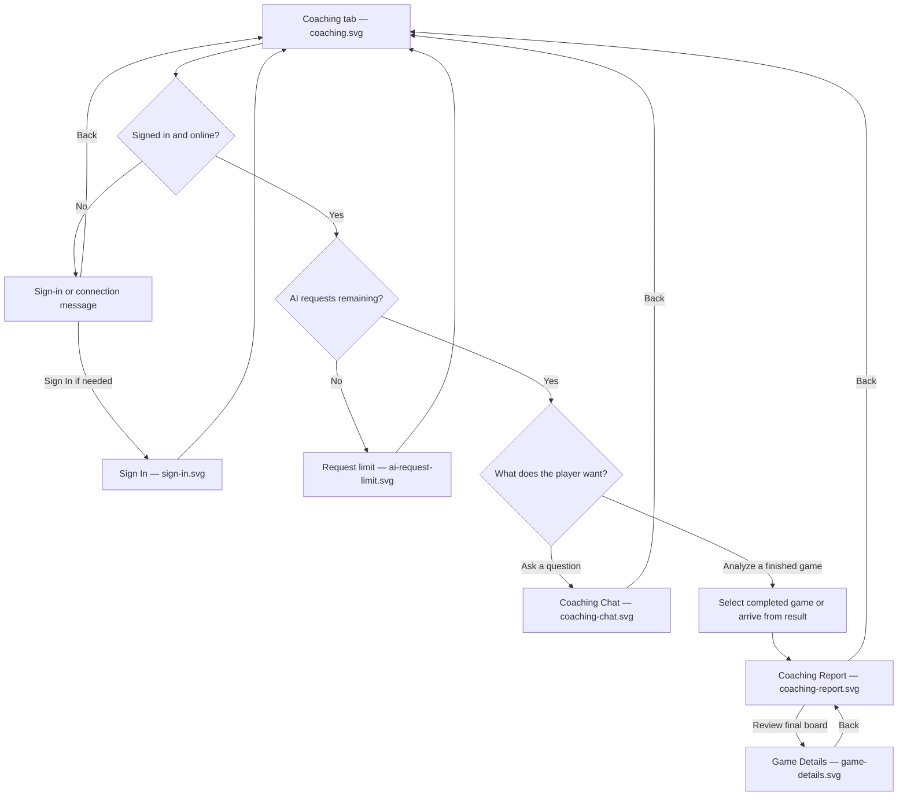
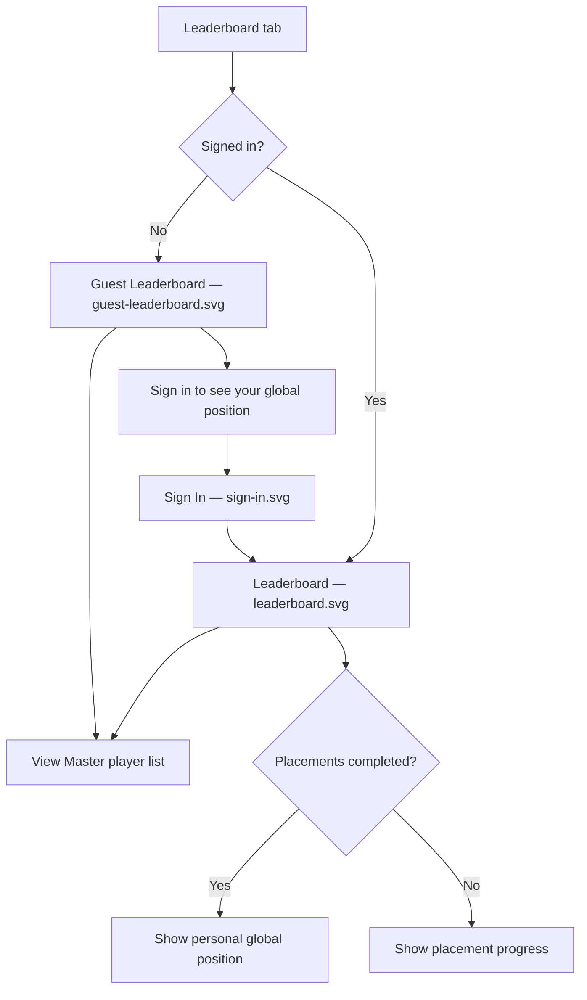
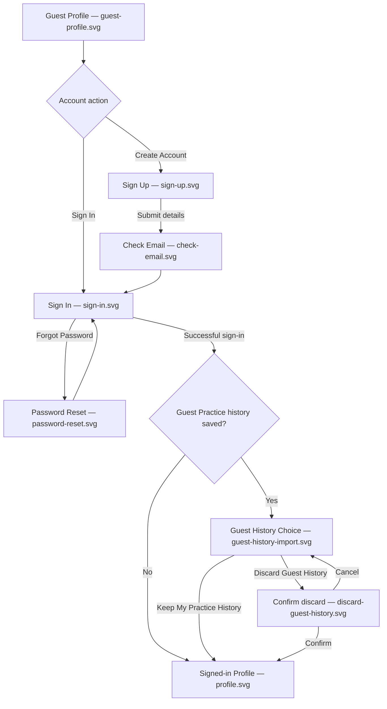
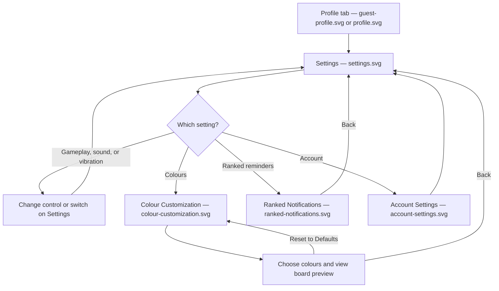
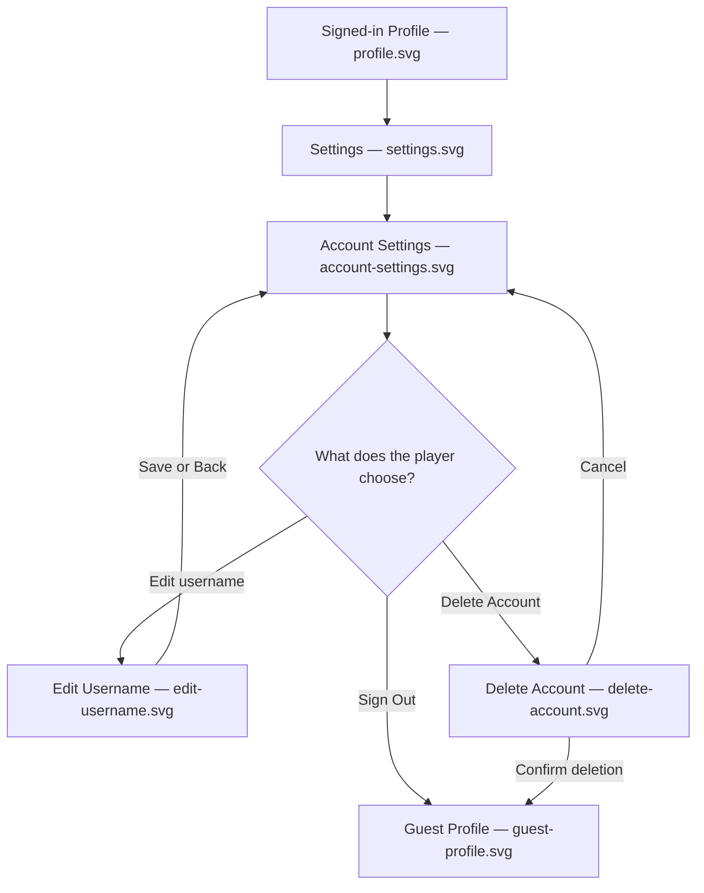

# MindSweeper — Phase 2 User Flows

## What this document covers

I'm designing MindSweeper as a mobile Minesweeper game with offline Practice Mode, online Ranked Mode, statistics, AI Coaching, a leaderboard, and player accounts. For Phase 2, I want to show how someone would actually move through the app, rather than just show a collection of screens.

My two main user stories are being able to **play Practice Mode anywhere, without an account or internet**, and being able to **sign in and play Ranked matches that count toward a player's rank**. I've also included the other flows needed to support those features, such as saving a game, viewing statistics, using Coaching, and managing an account.

These flows explain the planned experience. The screens are mockups, so none of the buttons or features are working yet.

## How navigation works

MindSweeper has five main tabs: **Play, Statistics, Coaching, Leaderboard, and Profile**. The app opens on **Play**, with Practice Mode selected. **Settings** is inside Profile rather than being a sixth tab.

I plan to use three types of navigation:

- **Tab navigation:** Moving between the five main areas of the app.
- **Stack navigation:** Opening another screen, such as a game, game history details, Sign In, or Settings, and using Back to return.
- **Confirmation screens or dialogs:** Asking the player to confirm important actions, such as replacing a saved game, discarding guest history, or deleting an account.

The diagrams use the actual mockup filenames wherever there's a matching SVG. An action such as starting a Ranked match may be shown as a step even if there isn't a separate SVG for that exact gameplay state.

---

## Flow 1 — Start and finish a Practice game

**User story:** As a player, I want to play Minesweeper without having to create an account or connect to the internet.

**Starting point:** The player opens MindSweeper and lands on the **Play** tab. Practice Mode is already selected.

The Play screen shows the three difficulty choices: Beginner (**9 × 9, 10 mines**), Intermediate (**16 × 16, 40 mines**), and Expert (**16 × 30, 99 mines**). Once the player starts, the game opens in a full-screen view so there's enough room for the board.

During the game, the player sees the board, timer, mine/flag counter, and controls. Tapping reveals a square, holding places a flag, and there's an optional Flag Mode. Larger boards need zoom and movement controls. The first square revealed should be safe and open an empty area. The game is won when all safe squares have been revealed, even if not every mine is flagged.

After a win or loss, the result screen shows the difficulty, time, moves, flags, and choices for what to do next. Players can also choose to request AI analysis, but that leads to the separate Coaching flow and isn't automatic. Practice works for guests and should not send them to Sign In.

**Navigation used:** Play **tab** → full-screen game in a **stack** → result screen → Play, Game Details, or Coaching.

## Flow 2 — Pause, resume, or replace a saved Practice game

**User story:** As a player, I want to leave an unfinished Practice game and continue it later without losing my progress.

**Starting point:** The player is in a Practice game, or returns to the Play tab with an unfinished game saved.

The paused screen keeps the board visible, but the timer is stopped and the player can't reveal or flag squares until they resume. If the app is closed or moved into the background, the unfinished Practice game should be saved and paused automatically.

When the player comes back, the Play tab shows a **Resume Game** option. If they choose to start something new instead, I want a confirmation before the saved game is replaced. Choosing Cancel keeps the old game. Choosing Replace starts the new game and removes the unfinished session being replaced.

**Navigation used:** Full-screen game **stack**, Play **tab**, and a **confirmation screen/dialog** for replacing a saved game.

## Flow 3 — Enter Ranked, complete placements, and see a result

**User story:** As a player, I want to sign in and play Ranked Minesweeper so my results count toward my rank.

**Starting point:** The player selects **Ranked** from the Play tab.

Ranked is only available to signed-in players with internet. If the player isn't signed in, they see **Sign In**, **Create Account**, and **Cancel**. If they're offline, the screen explains that Ranked needs an internet connection and that Practice is still available.

For now, every Ranked match uses **Intermediate (16 × 16, 40 mines)**. New players have **10 placement matches** before their starting rank is shown. The placement screen should show their progress, for example **5/10 completed**. Once placements are finished, the Ranked Lobby shows their rank badge, rank name, RP, progress to the next division, global position, and **Start Match** button.

For the example player in my mockups, I'd like to use **Gold II at 740 RP**, with **40/100 RP** shown toward Gold III. After a verified win, the results screen could show **+20 RP** and **YOUR RP: 760**. The RP shown on the different screens needs to match. A result shouldn't be shown as final until the match has been checked.

Ranked games can be interrupted, but the **board should be hidden while the match is paused or in the background**, unlike Practice. The planned allowance is **24 hours of paused time in total**. This is part of the experience, but I don't need to add a separate paused Ranked SVG to the current 36 mockups.

**Navigation used:** Play **tab** → an account/offline **decision screen**, or Ranked Lobby/Placements in the **stack** → gameplay → results → Ranked.

## Flow 4 — Check statistics and review a previous game

**User story:** As a player, I want to see how I'm improving and look back at games I've already played.

**Starting point:** The player selects the **Statistics** tab.

Practice Statistics should show games played, wins, losses, win percentage, and best times. The player can filter the numbers by **All, Beginner, Intermediate, or Expert**. These Practice stats should also be available to guests.

Ranked Statistics should show games played, wins, losses, win rate, current rank and RP, global position, and best Ranked time. I'd also like **Best Ranked Time** and **All-Time Highest Ranked** in separate, noticeable cards. For the example player, the highest rank could say **GOLD III (820)** even though their current rank is **Gold II (740 RP)**.

From the history list, the player can choose a game and see its final board. The Game Details view is for looking back, not making more moves. It should show the revealed numbers, mines, flags, and incorrectly placed flags marked with a red X. Players can zoom or centre the board if they need to.

**Navigation used:** Statistics **tab** → mode selection → Game History and Game Details in a **stack** → Back.

## Flow 5 — Ask the AI Coach a question or review a finished game

**User story:** As a player, I want help understanding Minesweeper patterns and feedback on games I've completed.

**Starting point:** The player opens the **Coaching** tab, or chooses AI analysis after finishing a Practice game.

The Coaching home screen should give the player two clear options: **Ask a Question** and **Analyze a Completed Game**. In the chat mockup, I'd like an example about the Minesweeper **1-2-1 pattern**. The board shown beside the explanation needs to be correct, so the AI isn't claiming a square is safe without enough information.

The completed-game report should show what the player did well, what they could improve, and a way to review their finished board. Players should only use an AI request when they choose to ask something or request analysis, not just because they finished a game.

Coaching needs an account and internet. Players have **10 AI requests per day**, resetting at **00:00 UTC**. The Coaching screen should show how many requests are left, and `ai-request-limit.svg` explains when they've used them all. There should be **no live AI hints during Ranked games**.

**Navigation used:** Coaching **tab** → Chat or Report in the **stack**; a finished Practice result can also lead into the report flow.

## Flow 6 — View the Master leaderboard and personal global rank

**User story:** As a player, I want to compare myself with other players, even if I haven't reached Master.

**Starting point:** The player selects the **Leaderboard** tab.

The public leaderboard shows **current Master players only**. Each row should show the player's position, username, and RP, with the purple **Master emblem** near the top of the page. I'd like to use names such as **MooseByte, CozyComet, NotMyMine, and FrostByte** in the example list.

Someone in Gold or Bronze won't appear in the public Master list, but if they've finished placements, they can still see their **own global position**. For example, a Gold II player might be **#428**, while a different Bronze II player could be **#1,283**. These are personal global rankings, not positions in the Master list.

Guests can still view the Master leaderboard, but the personal ranking area should say **“Sign in to see your global position.”** A signed-in player who hasn't completed placements should see their placement progress instead of a global position. For now, the leaderboard is read-only; clicking another player's name doesn't open a public profile.

**Navigation used:** Leaderboard **tab**, with Sign In opening in a **stack** if the guest chooses to sign in.

## Flow 7 — Create an account, sign in, and decide what happens to guest history

**User story:** As a guest, I want to create an account to use Ranked and Coaching, while choosing what happens to my Practice history.

**Starting point:** The player opens the **Guest Profile**, tries to enter Ranked, or chooses a feature that requires an account.

For Sign Up, I want **username, email, password, and confirm password** on the same screen. Usernames are **3–20 characters**, can contain letters, numbers, or underscores, and must be unique even if the capitalization is different. The password requirements should appear below the password field: **8 or more characters, an uppercase letter, a lowercase letter, and a number**. When the field is empty, the mockup should show an X beside each requirement.

Sign In should include **Enter Password**, a show/hide password button, **Forgot Password**, and the line **“No account needed for practice.”** After registration, the Check Email screen tells the player what to do next. The Password Reset screen shows how they would request a reset.

If the player has already played Practice as a guest, they must be asked whether to **Keep My Practice History** or **Discard Guest History** after signing in. Choosing Discard should lead to a second confirmation, with Cancel available. The history shouldn't disappear without the player choosing that option. After this, the player reaches their signed-in Profile or the feature they originally tried to open.

**Navigation used:** Profile **tab** or account-required screen → Sign In/Sign Up in a **stack** → guest history **decision/confirmation** → signed-in Profile or the requested feature.

## Flow 8 — Change game settings and colours

**User story:** As a player, I want to change the controls and colours so the game is comfortable for me to use.

**Starting point:** The player opens **Profile**, then **Settings**.

Settings should be available whether the player is signed in or using a guest profile. The main Settings screen should be organized into sections for gameplay controls, sound, vibration, colours, Ranked notifications, Coaching preferences, and account options.

The Gameplay section should show **long-press flagging or Flag Mode**, and **tapping numbers to open nearby squares or using a separate chord button**. Sound and vibration should have their own switches.

On the Colour Customization screen, the player can change the colours for numbers, flags, mines, covered and revealed squares, backgrounds, borders, and buttons. I want a small board preview and a **Reset to Defaults** button. The Ranked Notifications screen should show an option for a reminder when a paused Ranked game's time allowance is almost used up. These are still static mockups, so the controls are shown as examples of how the settings would work.

**Navigation used:** Profile **tab** → Settings in a **stack** → Colour Customization, Ranked Notifications, or Account Settings → Back.

## Flow 9 — Update account details or delete an account

**User story:** As a signed-in player, I want to manage my account and have a clear confirmation before making a permanent change.

**Starting point:** The signed-in player opens **Profile → Settings → Account**.

The Account Settings screen is where the player finds account information, security options, Sign Out, and Delete Account. I don't want the Delete Account button directly on the main Profile screen.

On Edit Username, show the existing username, a field for the new one, and a message explaining that usernames can only be changed **once every 30 days**. For Delete Account, the screen needs to explain that the account and saved progress will be permanently deleted, and ask the player to confirm. Choosing Cancel returns them to Account Settings without deleting anything.

Signing out returns the player to the guest experience. They can still play Practice without an account.

**Navigation used:** Profile **tab** → Settings → Account Settings in a **stack**, with a **confirmation screen** for deletion.

---

## Final check

These nine flows cover the two main user stories and the other screens needed to make the app understandable. They show where the player starts, which choices they have, what information they see or enter, and how they move between tabs, full-screen views, and confirmation screens.

I've kept the flows tied to the **36 planned SVG mockups**. Some actions, like an active Ranked match or a connection message in Coaching, are described as part of the experience without adding extra files to the mockup list. I'll use these flows when reviewing the mockups to make sure the screens connect in a way that makes sense before I start building the app.
